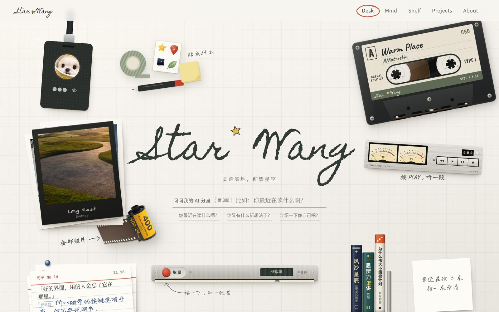
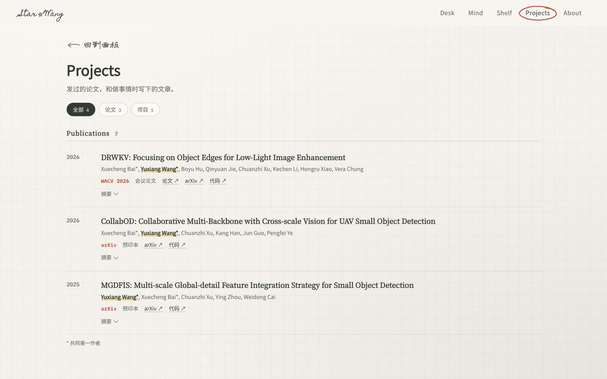
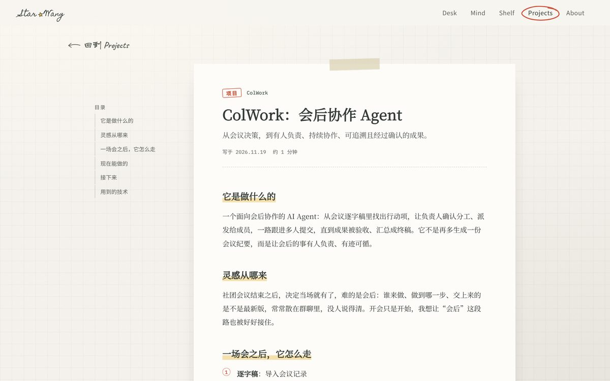
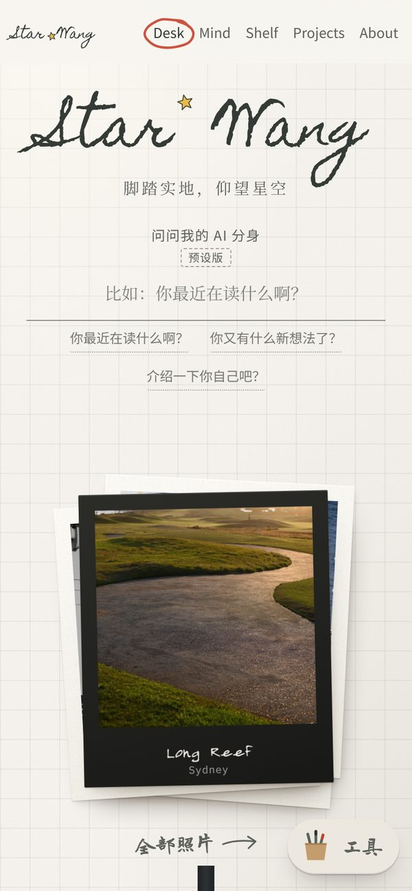

# Wang's Website

一块方格纸画板：照片、卡片、书架、论文和在做的东西，都摊在桌上。



## 页面

| 页面 | 里面有什么 |
| --- | --- |
| **Desk** | 首页画板：拍立得照片、卡片盒、在读的书、磁带机、取票机，还有可以贴贴纸、画画的文具角 |
| **Mind** | 卡片盒：随手记下的句子、看到的画面和冒出来的念头 |
| **Shelf** | 书架：按六个分类摆放，标出在读 / 读过 / 想读，在读的会出现在首页 |
| **Projects** | Publications 列表，和项目 / 实习写成的文章（每篇一页，`#/p/<id>`） |
| **About** | 工牌和联系方式 |

<p>
  
  
</p>





## 怎么做的

- **没有框架，也没有依赖。** 整站就是一个 `index.html`，样式和脚本都内联在里面，字体走 Google Fonts。
- **整页等比缩放。** 桌面按 1440 宽、手机按 390 宽排版，再整体缩放到窗口宽度，窗口怎么拉，版面的比例都不变。
- **开发端和展示端分开。** 只有我自己能切到开发端，在页面上直接写文章、加书、加卡片、改「最近」和 AI 分身的预设回答；访客看到的永远是展示端。
- **项目写成文章。** Projects 不再给每个项目单独排版，而是一篇篇文章：列表按「项目」「实习」分开，文章页有目录、阅读进度和同一项目的其他文章，手机上目录收进折叠栏，打印时只留正文。
- **数据放在哪。** 书和卡片的默认内容写在 `parts/site.js`；在开发端改过的内容存进页面所在平台的数据库。访客取的票、贴的贴纸只留在他们自己的浏览器里。

<br clear="right">

## 目录

```text
.
├── index.html        构建好的整页，直接打开就能看
├── build.py          把 parts/ 拼成 index.html
├── parts/            源码
│   ├── pages.html    页面结构
│   ├── site.js       内容：卡片、书、照片、贴纸，以及路由
│   ├── v9.js         书架、Projects、取票机、开发端等
│   ├── *.css         样式
│   └── legacy/       早期版本留下来的模块（工牌、收集册等）
├── photos/  real/    图片
├── audio/            磁带音频（不在仓库里，见下方说明）
├── docs/             README 用的截图
└── tests/            Playwright 浏览器测试
```

## 本地运行

```bash
python3 build.py               # 改了 parts/ 之后，重新生成 index.html
python3 -m http.server 8768    # 然后打开 http://127.0.0.1:8768/
```

在地址后面加 `?dev`（只在 `127.0.0.1` 上生效）就是本地的开发端，改动只存在当前浏览器里。

## 写文章

开发端的 Projects 页有「＋ 写一篇」。正文用一小套 Markdown：

```text
## 小标题          ### 小小标题
- 列表             1. 步骤
> 引用             **加粗**   `代码`
[文字](网址)       
``` 代码块 ```     --- 分隔线
```

空一行分段。链接一行一个，写成「名字 网址」。

## 测试

```bash
pip install playwright && playwright install chromium
python3 -m http.server 8768 &
python3 tests/t9.py
```

`tests/t9.py` 会走一遍 AI 分身、换画纸、取票撕存根、书架和开发端编辑；`tests/t10_posts.py` 走 Projects 和文章页（筛选、目录、阅读进度、写一篇、打印）。桌面和手机尺寸各跑一次。

## 素材说明

- 照片和文字是我自己的。
- 书的简介只摘官方简介里的一句，并附原文链接；封面是排版生成的，没有使用出版社的封面图。
- 磁带里的歌（Warm Place — AMatroskin）有版权，没有放进仓库。本地想听的话，把音频文件放到 `audio/warm-place.mp3`。
