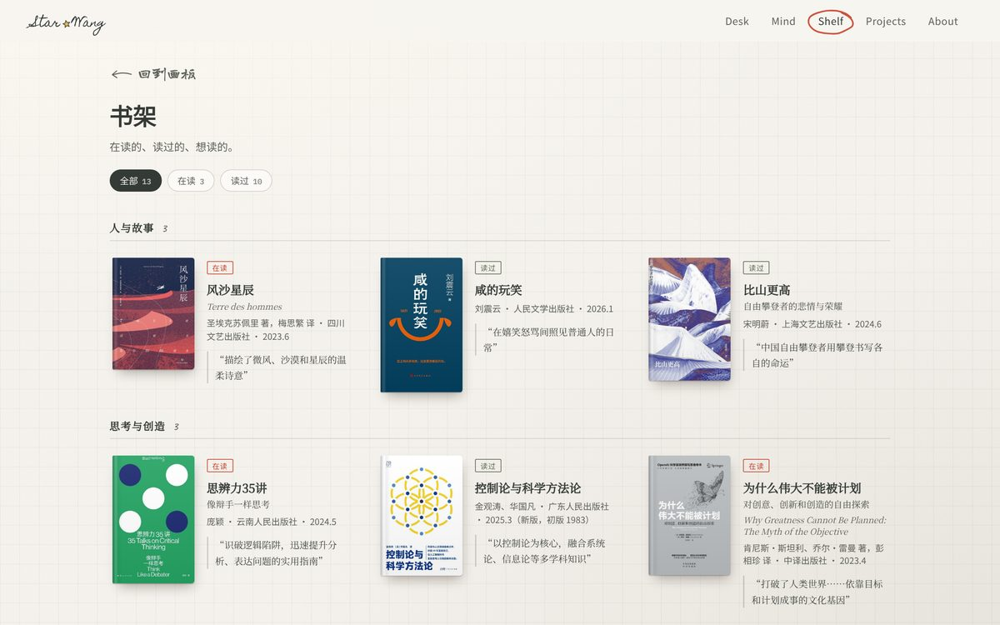

# Star Wang

我的个人网站。一块方格纸画板，照片、卡片、在读的书、论文和在做的项目都摊在上面。


## 页面

| 页面 | 内容 |
| --- | --- |
| Desk | 首页画板：工牌、拍立得、卡片盒、磁带机、取票机、在读的书。可以贴贴纸、画几笔，再把整块画板存成一张图 |
| Mind | 卡片盒：随手记下的句子、看到的画面、冒出来的念头 |
| Shelf | 书架：按分类摆放，标出在读和读过，点一本书打开它的豆瓣页 |
| Projects | Publications，以及项目和实习写成的文章 |
| About | 工牌和联系方式 |

<table>
  <tr>
    <td width="50%" valign="top"><br><sub>Shelf</sub></td>
    <td width="50%" valign="top"><br><sub>Projects</sub></td>
  </tr>
  <tr>
    <td valign="top"><br><sub>文章页</sub></td>
    <td valign="top"><br><sub>存成一张图</sub></td>
  </tr>
</table>

## 怎么做的

- **一个 HTML 文件。** 不用框架，`parts/` 里的样式、页面和脚本由 `build.py` 拼成 `index.html`，直接打开就能看。
- **整页等比缩放。** 桌面按 1440 宽、手机按 390 宽排版，再整体缩放到窗口宽度，窗口怎么拉，版面比例都不变。
- **开发端和展示端分开。** 我在开发端直接在页面上写文章、加书、换封面、改预设回答；访客只能用页面给出的入口。
- **存成一张图。** 用 html-to-image 把整块画板画成 PNG，底边印上保存时间。手写体和等宽体打包在 `fonts/export.css` 里，图里的字和网页上一样。
- **数据放在哪。** 默认内容写在 `parts/site.js`；开发端改过的内容存进托管平台的数据库；访客取的票、贴的贴纸只留在他们自己的浏览器里。


## 本地运行

只需要 Python 3：

```bash
python3 build.py               # 改了 parts/ 之后重新生成 index.html
python3 -m http.server 8768    # 打开 http://127.0.0.1:8768/
```

地址后面加 `?dev` 进入本地开发端（只在 `127.0.0.1` 上生效），改动只存在当前浏览器里。

### 测试

测试用 Playwright 在桌面和手机两种尺寸下走一遍页面。先起本地服务器，再跑测试：

```bash
pip install playwright
playwright install chromium
python3 -m http.server 8768 &
python3 tests/t9.py
```

默认访问 `http://127.0.0.1:8768/index.html`，用环境变量 `SITE_URL` 可以换成别的地址。

| 文件 | 覆盖的内容 |
| --- | --- |
| `t8.py` | 各种窗口宽度下的等比缩放 |
| `t8pages.py` | 各个页面能正常打开，可以传宽度：`python3 tests/t8pages.py 390` |
| `t8live.py` | 取票、打孔、签名、撕存根 |
| `t8diy.py` | 贴纸、画笔和「寄给我」 |
| `t9.py` | AI 分身、换画纸、书架和开发端编辑 |
| `t10_posts.py` | Projects 和文章页：筛选、目录、阅读进度、写一篇、打印 |
| `t11_sign.py` | 签名时跟着鼠标的钢笔 |
| `t12_answers.py` | AI 分身的回答写在纸上、翻页和关闭 |

### 更新导出字体

页面上加了新字以后，重新生成 `fonts/export.css`，否则存成图时新字会换成系统字体：

```bash
npm install @fontsource/caveat @fontsource/oswald @fontsource/ibm-plex-mono @fontsource/homemade-apple @fontsource/long-cang
pip install fonttools brotli
python3 build.py
python3 tools/build_export_fonts.py
```

字体也可以放在别处，用 `FONTSOURCE_DIR` 指过去。

## 写文章

在开发端的 Projects 页点「＋ 写一篇」。正文支持一小套 Markdown，空一行分段：

| 写法 | 效果 |
| --- | --- |
| `## 小标题` | 二级标题，会出现在文章目录里 |
| `### 小小标题` | 三级标题 |
| `- 列表`、`1. 步骤` | 无序列表、有序列表 |
| `> 引用` | 引用 |
| `**加粗**`、`` `代码` `` | 加粗、行内代码 |
| `[文字](网址)` | 链接 |
| `` | 图片；也可以点「插入图片」，或者直接粘贴、拖进编辑框 |
| `---` | 分隔线 |

代码块用三个反引号包起来：

````text
```
代码
```
````

## 目录结构

```text
.
├── index.html       构建好的整页
├── build.py         把 parts/ 拼成 index.html
├── parts/           源码
│   ├── pages.html   页面结构
│   ├── site.js      内容（卡片、书、照片、贴纸）和路由
│   ├── v9.js        书架、Projects、取票机、开发端等
│   ├── *.css        样式
│   └── legacy/      早期版本留下来的模块（工牌、收集册等）
├── photos/  real/   照片和道具图
├── covers/          书的封面
├── fonts/           存成图时用的字体子集
├── tools/           生成字体子集的脚本
├── audio/           磁带音频（不在仓库里，见下方）
├── docs/            README 里的截图
└── tests/           Playwright 测试
```

## 致谢

- 字体：[Caveat](https://fonts.google.com/specimen/Caveat)、[Homemade Apple](https://fonts.google.com/specimen/Homemade+Apple)、[IBM Plex Mono](https://fonts.google.com/specimen/IBM+Plex+Mono)、[Long Cang](https://fonts.google.com/specimen/Long+Cang)、[Noto Sans SC](https://fonts.google.com/noto/specimen/Noto+Sans+SC)、[Noto Serif SC](https://fonts.google.com/noto/specimen/Noto+Serif+SC)、[Oswald](https://fonts.google.com/specimen/Oswald)，来自 Google Fonts，按各自的 OFL 或 Apache 2.0 许可使用
- [html-to-image](https://github.com/bubkoo/html-to-image)：存成一张图
- [Playwright](https://playwright.dev/python/)：浏览器测试

## 版权

- 照片、文字和网站设计归我所有，保留所有权利。代码公开出来方便参考，请不要整站照搬。
- 书的封面版权归各出版社，这里只用来展示我读过的书；每本书的一句话介绍摘自书的官方简介。
- 磁带里的歌（Warm Place，AMatroskin）有版权，没有放进仓库。本地想听，把音频放到 `audio/warm-place.mp3`。

## 联系

- 邮箱：w_wangyi163@163.com
- [Google Scholar](https://scholar.google.com/citations?user=dpUx9HgAAAAJ&hl=zh-CN)
